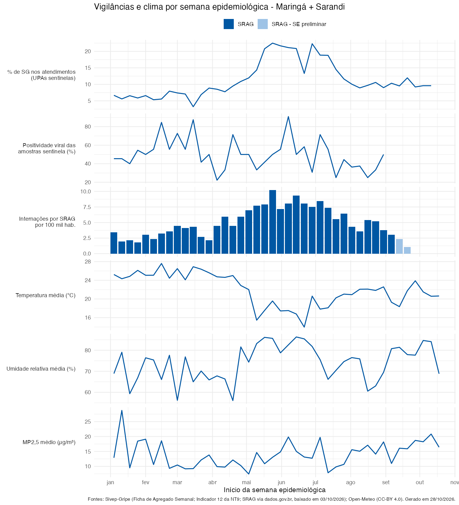

```{r}
#| label: setup
source("_comum.R")
```

Este painel coloca lado a lado, por semana epidemiológica (SE), as duas vigilâncias de vírus respiratórios da 15ª Regional de Saúde de Maringá e as condições de clima e qualidade do ar da região.

| | Vigilância Sentinela de SG | Vigilância Universal de SRAG |
|---|---|---|
| **Quem entra** | Pacientes com Síndrome Gripal atendidos nas 2 UPAs sentinelas (Zona Sul/Maringá e Sarandi) | Todos os pacientes **internados** por SRAG, residentes na 15ª RS |
| **Para que serve** | Acompanhar a circulação viral: cada unidade coleta amostras de **5 casos de SG por semana** | Medir a gravidade: internações, UTI e óbitos |
| **Indicador usado aqui** | % de atendimentos por SG no total de atendimentos da unidade; positividade viral das amostras | Internações por SRAG por 100 mil habitantes, por SE de início dos sintomas |

```{r}
#| label: cartoes
#| output: asis
if (!is.null(serie) && !is.null(referencias)) {
  rs <- serie |> filter(recorte == "15ª RS")

  ultima_sg <- rs |> filter(!is.na(sg_pct)) |> slice_max(inicio_se, n = 1)
  ultima_srag <- rs |> filter(!is.na(srag_casos), !srag_preliminar) |>
    slice_max(inicio_se, n = 1)
  ultima_viral <- rs |> filter(!is.na(positividade_pct)) |> slice_max(inicio_se, n = 1)

  cartao <- function(rotulo, valor, detalhe) {
    paste0('<div class="cartao"><div class="rotulo">', rotulo, '</div>',
           '<div class="valor">', valor, '</div>',
           '<div class="detalhe">', detalhe, '</div></div>')
  }

  cat('<div class="cartoes">',
      cartao("% de SG nas UPAs sentinelas",
             paste0(formatar_num(ultima_sg$sg_pct), "%"),
             paste0("SE ", formatar_se(ultima_sg$SE), " · ",
                    formatar_num(ultima_sg$sg_atend_sg, 0), " de ",
                    formatar_num(ultima_sg$sg_atend_tot, 0), " atendimentos")),
      cartao("Positividade viral (sentinela)",
             paste0(formatar_num(ultima_viral$positividade_pct, 0), "%"),
             paste0("SE ", formatar_se(ultima_viral$SE), " · ",
                    ultima_viral$amostras_virus, " de ", ultima_viral$amostras, " amostras")),
      cartao("Internações por SRAG (15ª RS)",
             formatar_num(ultima_srag$srag_casos, 0),
             paste0("SE ", formatar_se(ultima_srag$SE), " · ",
                    formatar_num(ultima_srag$srag_taxa_100mil), " por 100 mil hab.")),
      cartao("Temperatura média (15ª RS)",
             paste0(formatar_num(ultima_sg$temp_media), " °C"),
             paste0("SE ", formatar_se(ultima_sg$SE))),
      '</div>', sep = "\n")
}
```

::: {.aviso-dado}
**Datas diferentes em cada fonte.** As vigilâncias não fecham na mesma semana: a sentinela depende do export manual do Sivep-Gripe, e o SRAG vem do arquivo da API baixado pelo painel de SRAG. As **últimas `r if (!is.null(referencias)) referencias$semanas_prelim else 3` SE do SRAG** antes da data do download aparecem em azul-claro e ficam fora das correlações, porque ainda vão receber notificações atrasadas.
:::

## Linha do tempo

::: {.panel-tabset}

### 15ª RS

SRAG de residentes dos 30 municípios; clima médio da região, ponderado pela população.


### Maringá + Sarandi

SRAG só de residentes dos 2 municípios onde ficam as UPAs sentinelas — o recorte mais comparável com a sentinela.



:::

```{r}
#| label: rodape-datas
#| output: asis
if (!is.null(referencias)) {
  cat(paste0(
    "*Painel gerado em ", formatar_data(referencias$gerado_em),
    ". SRAG: arquivo da API baixado em ", formatar_data(referencias$extracao_srag),
    ". Sentinela: % de SG até a SE ", formatar_se(referencias$ultima_se_sg),
    "; positividade viral até a SE ", formatar_se(referencias$ultima_se_viral), ".*"
  ))
}
```
