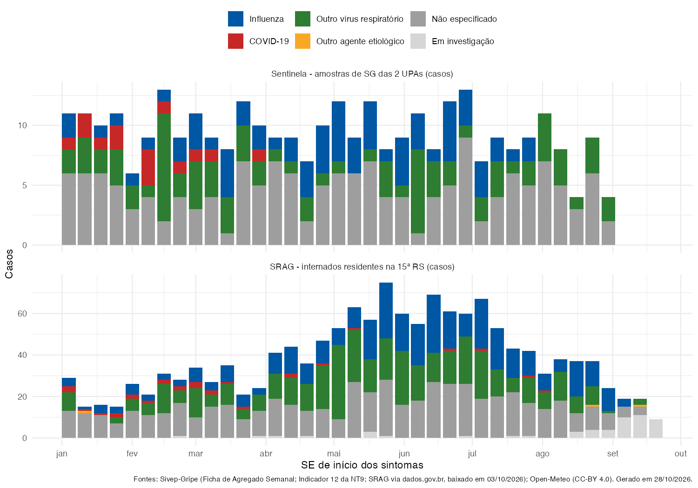

```{r}
#| label: setup
source("_comum.R")

rotulo_antecedencia <- function(k) {
  ifelse(k == 0, "Mesma semana",
         paste0(k, ifelse(k == 1, " semana antes", " semanas antes")))
}
```

## A sentinela antecipa as internações?

Correlação de Spearman entre o indicador da sentinela numa semana e a taxa de internação por SRAG na mesma semana ou de 1 a 4 semanas **depois**. Se a correlação for maior com algumas semanas de antecedência, a sentinela estaria "avisando" antes do aumento de internações.

Valores de **rho** vão de −1 a +1; perto de 0, sem relação. Em **negrito**, p < 0,05. SE preliminares do SRAG ficam de fora.

::: {.panel-tabset}

### 15ª RS

```{r}
#| label: lead-lag-rs
if (is.null(correlacoes)) aviso_sem_dado() else
  correlacoes |>
    filter(tipo == "Sentinela x SRAG", recorte == "15ª RS") |>
    tabela_correlacao(rotulos_variaveis[c("sg_pct", "positividade_pct")],
                      rotulo_antecedencia)
```

### Maringá + Sarandi

```{r}
#| label: lead-lag-ms
if (is.null(correlacoes)) aviso_sem_dado() else
  correlacoes |>
    filter(tipo == "Sentinela x SRAG", recorte == "Maringá + Sarandi") |>
    tabela_correlacao(rotulos_variaveis[c("sg_pct", "positividade_pct")],
                      rotulo_antecedencia)
```

:::

::: {.aviso-dado}
**Como ler.** As duas vigilâncias sobem e descem juntas na temporada, então a correlação na mesma semana já é alta. [Inferência] Uma correlação parecida com 1 semana de antecedência não prova que a sentinela "chega antes": em uma única temporada, séries que sobem e descem devagar ficam correlacionadas em várias defasagens. Para afirmar antecipação seria preciso mais temporadas.

A **positividade viral** da sentinela vem de cerca de 10 amostras por semana (5 por unidade), então oscila muito de uma semana para outra — o que tende a enfraquecer qualquer correlação.
:::

## Vírus identificados nas duas vigilâncias

Sentinela: classificação final das amostras de SG das 2 UPAs (Indicador 12 da NT9; Influenza A e B somadas). SRAG: classificação final dos casos internados residentes na 15ª RS. As últimas semanas do SRAG ainda têm muitos casos "em investigação" (aguardando resultado de exame).



## Série semanal — 15ª RS

```{r}
#| label: tabela-serie
if (is.null(serie)) aviso_sem_dado() else
  serie |>
    filter(recorte == "15ª RS") |>
    arrange(desc(inicio_se)) |>
    transmute(
      SE = formatar_se(SE),
      `Início` = formatar_data(inicio_se),
      `% SG (sentinela)` = sg_pct,
      `Amostras` = amostras,
      `Positividade (%)` = positividade_pct,
      `SRAG internações` = srag_casos,
      `SRAG / 100 mil` = srag_taxa_100mil,
      `UTI` = srag_uti,
      `Óbitos` = srag_obitos,
      `Preliminar` = ifelse(srag_preliminar %in% TRUE, "sim", "")
    ) |>
    gt::gt() |>
    gt::fmt_number(columns = c(`% SG (sentinela)`, `Positividade (%)`, `SRAG / 100 mil`),
                   decimals = 1, dec_mark = ",") |>
    gt::sub_missing(missing_text = "—") |>
    gt::cols_align(align = "center") |>
    gt::opt_interactive(use_pagination = TRUE, page_size_default = 10,
                        use_compact_mode = TRUE) |>
    estilo_tabela()
```

[Baixar a série completa (CSV separado por `;`)](dados/serie_semanal.csv) · [Vírus por semana](dados/virus_semanal.csv)
